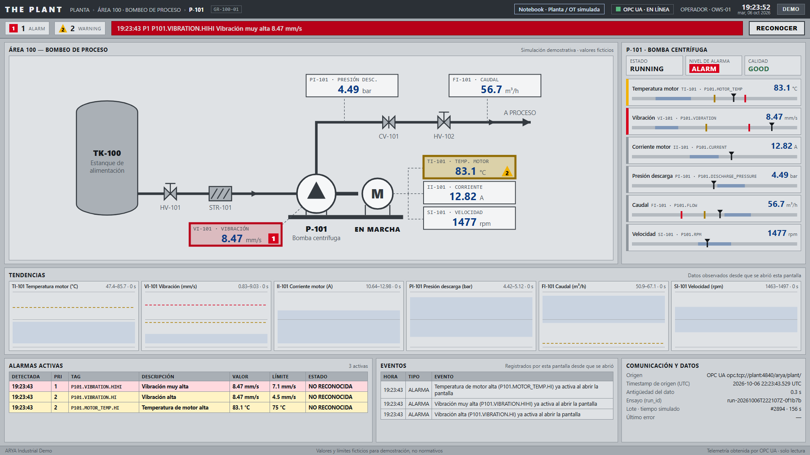
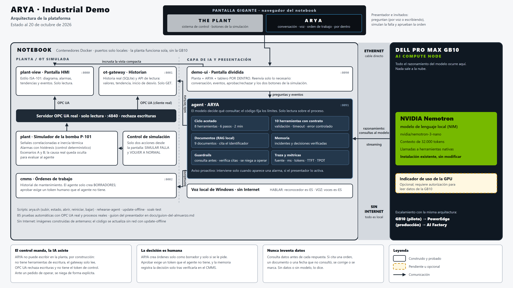
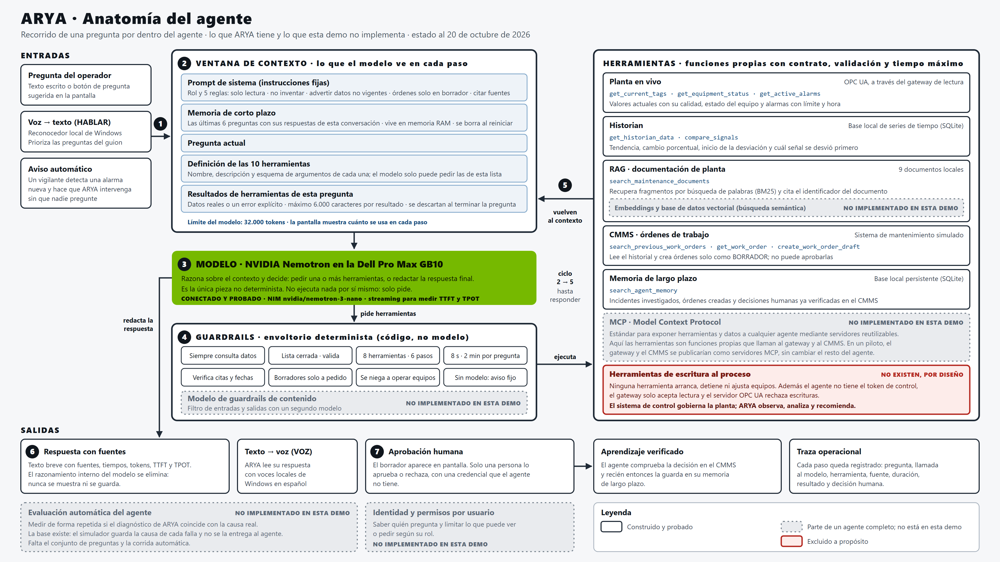

# ARYA · agente de IA industrial

ARYA es un agente de IA que investiga fallas en una bomba industrial. Lee la planta por **OPC UA**, cruza alarmas, tendencias, historial de mantenimiento y manuales, anticipa desgastes con seis meses de historia y deja **órdenes de trabajo en borrador para que una persona las apruebe**. Nunca escribe en la planta.

Razona con **NVIDIA Nemotron** servido como NIM en una **Dell Pro Max GB10**, en local y sin nube.

| Real | Simulado |
|---|---|
| El agente, sus 14 herramientas y sus límites | La planta: bomba P-101, sus alarmas y su física |
| El modelo (Nemotron) y la GB10 | El historial de seis meses |
| OPC UA (servidor y clientes reales), historian y CMMS de demostración | Las órdenes de trabajo anteriores y la ficha técnica de la bomba |







## Qué muestra

- **Escenario A y B:** dos fallas reactivas. ARYA correlaciona los síntomas, consulta el historial y los manuales, y propone una orden de trabajo.
- **Escenario C (predictivo):** pequeñas desviaciones de vibración y temperatura a lo largo de semanas. ARYA las compara con la historia (bronce, plata y oro), proyecta un rango, elige la próxima parada planificada y deja una orden PREDICTIVA.
- **Por dentro:** cada paso del agente se ve en vivo: herramientas, tiempos, tokens, TTFT y TPOT.
- **Rechazos:** pídele que pare la bomba o que reconozca una alarma; dirá que no puede y por qué.

## El libro

[`docs/libro/`](docs/libro/) cuenta en español cómo se construyó ARYA desde cero, con el código real extraído del repositorio. Ábrelo en `docs/libro/libro-arya.html`, o regenéralo con `python docs/libro/build.py`. El [`tutorial/`](tutorial/) reproduce los primeros pasos en archivos pequeños.

## Empezar

Necesitas Docker y un endpoint compatible con OpenAI que sirva un modelo con *tool calling*; la demo se probó con `nvidia/nemotron-3-nano` en un NIM. Sin modelo, la planta funciona y ARYA avisa que no puede responder.

```bash
git clone https://github.com/donosojesus/arya-agente-industrial.git
cd arya-agente-industrial
./scripts/start-demo.sh --build     # la primera vez, con Internet; crea .env con secretos locales
# edita NEMOTRON_BASE_URL en .env para apuntar a tu modelo y vuelve a ejecutar start-demo.sh
./scripts/open-demo.sh              # pantalla dividida: planta + ARYA
```

Guía completa: [INSTALAR-EN-PC-NUEVO.md](INSTALAR-EN-PC-NUEVO.md) · [arquitectura](docs/architecture.md) · [validación](docs/validation.md).

## Licencia y marcas

Código y documentación bajo [Apache 2.0](LICENSE). Dell, Dell Pro Max, NVIDIA, Nemotron y NIM son marcas de sus dueños y se nombran como referencia técnica; este proyecto no está afiliado a ellos. La planta, sus datos y sus documentos son ficticios.

## Uso (WSL)

Requisito: **Docker Desktop abierto** con el motor en marcha.

```bash
cd arya-agente-industrial

./scripts/start-demo.sh            # arranca (offline: solo imágenes ya construidas)
./scripts/preflight.sh             # debe terminar en PLANT READY
./scripts/open-demo.sh             # abre la pantalla dividida (planta + ARYA) lista para presentar
./scripts/open-scada.sh            # abre solo la pantalla completa de la planta
./scripts/inject-fault.sh          # falla del escenario A (3 minutos)
./scripts/inject-fault.sh bravo    # falla del escenario B
./scripts/normal-operation.sh      # retira la falla; la planta se recupera gradualmente
./scripts/reset-demo.sh            # planta, CMMS y ARYA al estado inicial
./scripts/demo-status.sh           # resumen
./scripts/stop-demo.sh             # detiene y libera recursos
```

- **Preparación con Internet (una vez, o tras cambiar código):** `./scripts/start-demo.sh --build`.
- **Arranque offline (el resto de las veces):** `./scripts/start-demo.sh`. No construye ni descarga.
- La primera ejecución crea `.env` y genera ahí los secretos locales. No se suben a Git ni se imprimen.
- **Cambios de código sin Internet:** `./scripts/update-offline.sh <servicio>` actualiza el
  código sobre la imagen local (no sirve para cambiar dependencias).
- **Ensayo del diálogo con el modelo real:** `./scripts/rehearse-agent.sh`.
- **Prueba de resistencia:** `./scripts/soak-test.sh 3` (horas, sin fallas; `--with-faults` las agrega cada 20 min); al final imprime un resumen.

Hay equivalentes PowerShell (`.ps1`) para arrancar, detener, inyectar, reiniciar,
preflight y estado; se ejecutan con `powershell -ExecutionPolicy Bypass -File .\scripts\<nombre>.ps1`.
`schedule-fault` y el modo respaldo existen solo en `.sh`.

## La pantalla dividida (para presentar)

**http://127.0.0.1:8090**, o `./scripts/open-demo.sh`, que además carga los
tokens del presentador y de aprobación.

- **Izquierda:** la planta en vista compacta (sistema de control, gris).
- **Derecha:** ARYA (oscuro), con su estado, la conversación, preguntas
  sugeridas a un clic, la tarjeta de la orden de trabajo con APROBAR / RECHAZAR
  y la traza **INSIDE THE AGENT**: cada herramienta usada, su fuente, su
  duración y su resultado.
- **Controles de la simulación**, a la vista bajo la planta: **SIMULAR FALLA**
  (escenario A o B) y **VOLVER A NORMAL** (recuperación gradual), con el estado de la
  falla. La falla solo empieza cuando alguien pulsa el botón. Funcionan aunque la
  pantalla se abra escribiendo la URL: el servidor de la pantalla agrega el token del
  presentador, solo para estas dos acciones y solo si la petición viene de la propia
  pantalla de la demo. El reinicio completo queda en el panel DEMO de la planta y en
  `reset-demo.sh`. Aprobar órdenes sigue exigiendo su propio token.
- **Tokens:** cada respuesta muestra los tokens usados, y el tablero POR DENTRO muestra
  cuánto ocupa el contexto frente al límite del modelo (32 000) y el total de la conversación.
- **Tres modos:** REPOSO (la planta ocupa casi todo), CONVERSACIÓN (mitad y
  mitad) y POR DENTRO. Pasa sola de reposo a conversación cuando alguien
  pregunta o cuando ARYA avisa por su cuenta, y vuelve a reposo tras 4 minutos
  sin actividad.
- **POR DENTRO:** un tablero con el ciclo Percibir, Razonar, Actuar, Observar y
  diez tarjetas (modelo, prompt, contexto, memoria, RAG, percepción,
  herramientas, MCP, guardrails, observabilidad). Cada bloque se enciende
  cuando ARYA lo usa de verdad, con el dato real: herramienta, fuente,
  milisegundos, tokens, documento citado. MCP queda en gris: no está en esta
  demo. El botón **REPETIR LA ÚLTIMA PREGUNTA POR DENTRO** vuelve a pasar, más
  lento, la traza real de la respuesta anterior. En este modo la planta no se ve.

  Como una herramienta tarda milisegundos, el tablero muestra los eventos en su
  orden real pero a un ritmo visible; va unos segundos por detrás del agente.
- **VOZ:** ARYA lee en voz alta sus respuestas con una voz local de Windows en
  español (Pablo, Laura o Helena). Funciona sin Internet; nunca usa voces en línea.
  Viene apagada: se activa con el botón. Si el equipo no tiene una voz local en
  español, el botón dice "NO DISPONIBLE".
- **HABLAR:** se le puede hablar a ARYA. Usa el reconocedor de voz en español que
  trae Windows, sin Internet (`scripts/voice-listener.ps1`, en http://localhost:8095;
  `arya.sh up` lo inicia y `arya.sh down` lo detiene). Se pulsa HABLAR, se dice la
  pregunta y termina sola con una pausa. Las preguntas del guion
  (`data/voice-phrases.txt`) se reconocen con prioridad y se envían solas; lo demás
  queda escrito en la caja para revisarlo antes de enviar. El reconocimiento de los
  navegadores no se usa porque necesita Internet.
- **LIMPIAR:** borra la conversación y vacía la pantalla y la traza. ARYA olvida el
  contexto de esa conversación; no se borran su memoria de largo plazo, las
  órdenes del CMMS ni el registro de auditoría. Una orden que espera decisión
  sigue a la vista.
- **Aviso automático:** con la casilla activada, ARYA interviene sin que le
  pregunten cuando aparece una alarma. Viene desactivado.

El modelo se configura en `.env` (`NEMOTRON_BASE_URL`, `NEMOTRON_MODEL`,
`LLM_THINKING`). El razonamiento del modelo va apagado: con él encendido cada paso
tarda unos 15 s en vez de menos de 1 s.

## Del agente a la AI Factory (ventana aparte)

**http://127.0.0.1:8090/factory**, o `./arya.sh factory`, que la abre en una
ventana nueva. Es independiente y solo lee: no modifica la simulación.

- **Etapa 1, el piloto (medido):** Dell Pro Max GB10 con los tokens por consulta, el
  tiempo de respuesta y el TTFT/TPOT que mide ARYA en vivo. Sin respuestas recientes,
  usa las mediciones del ensayo del 19 de octubre, rotuladas así.
- **Hilo:** el ciclo de la Dell AI Factory (caso de uso piloto → probar y validar →
  escalar a producción → desplegar → siguientes casos de uso).
- **Etapas 2 y 3 (proyección):** la arquitectura de referencia NVIDIA 2-8-5-200 que
  publica Dell (hasta 16 PowerEdge XE7745 con 8 RTX PRO 6000 Blackwell, 4 PowerEdge
  R670 de control, PowerScale F710, NVIDIA Spectrum-4 SN5610) y los casos de uso que
  nombra Dell, con ARYA como plataforma de IA agéntica.
- **VER EL STACK COMPLETO:** las capas tal como las dibuja Dell (infraestructura,
  orquestación de contenedores con sus operadores, herramientas y modelos, casos de uso,
  gestión y Dell Services) con una columna de lo que corre hoy en este piloto.
  Directo: http://127.0.0.1:8090/factory?view=stack
  Fuente: Solution Brief "Dell AI Factory with NVIDIA", configuración 2-8-5-200 (julio de 2026).
- **Calculadora:** plantas, agentes, consultas, cámaras y activos; calcula GPUs,
  servidores XE7745, tokens y almacenamiento. Los supuestos son visibles y editables.
- **¿CÓMO LA PROTEGEMOS?:** botón en la etapa 3 que muestra la arquitectura de
  protección en cinco capas (segmentación OT según IEC 62443, identidad y acceso,
  PowerProtect Data Manager con Data Domain inmutable, bóveda PowerProtect Cyber
  Recovery con CyberSense, y riesgos propios de la IA). Cada capa indica qué ya
  funciona en ARYA y qué es arquitectura de referencia; al pulsar una capa se
  resalta en el mapa. Directo: http://127.0.0.1:8090/factory?view=protect

## La pantalla de la planta

**http://127.0.0.1:8080** (o `open-scada`, que además carga el token).

Sigue el estilo de los sistemas de control actuales (ISA-101, "HMI de alto
desempeño"): fondo gris, equipos en 2D, color reservado para alarmas.

- Barra de alarmas con prioridad 1 (ALARM) y 2 (WARNING) y botón **RECONOCER**.
  Una alarma sin reconocer parpadea; reconocerla solo cambia la presentación.
- Diagrama de proceso del Área 100 con instrumentos etiquetados (TI-101, VI-101,
  II-101, PI-101, FI-101, SI-101).
- Barras analógicas con rango normal, límites y valor actual.
- Tendencias, tabla de alarmas activas y diario de eventos, todo con lo
  observado desde que se abrió la pantalla.
- Si se pierde la conexión, los valores quedan marcados como desactualizados
  con el error; nunca se reemplazan por ceros ni por valores inventados.

Hay además una **vista compacta** en http://127.0.0.1:8080/compact, con los
mismos datos y menos paneles (diagrama, alarmas y tres tendencias). Está pensada
para ocupar media pantalla junto a la interfaz del agente.

Los controles del presentador están en el botón **DEMO** (arriba a la derecha),
para que la pantalla principal se vea como la de una planta:

| Control | Qué hace |
|---|---|
| **INJECT FAULT** | Inicia la falla del escenario elegido (A o B). Evoluciona en unos 3 minutos. |
| **NORMAL OPERATION** | Retira la falla. No es instantáneo: los valores vuelven gradualmente y las alarmas se liberan solas. |
| **RESET DEMO** | Reinicia la simulación de inmediato con un ensayo nuevo. |

Los dos escenarios se distinguen en los datos:

| | Escenario A | Escenario B |
|---|---|---|
| Sube | Vibración y, después, temperatura; algo la corriente | Algo la vibración, que se vuelve irregular |
| Baja | Un poco el caudal y la presión | Mucho el caudal y la presión; también la corriente |
| Alarmas | Vibración y temperatura | Bajo caudal |

La bomba sigue `RUNNING` con la alarma activa: no se simula un disparo de protección.

## Servicios y puertos

| Servicio | Puerto | Uso | Publicación |
|---|---|---|---|
| `plant` | 4840 | OPC UA, solo lectura | Loopback (`OPCUA_BIND`) |
| `plant` | 9001 | Controles del presentador, con token | **Siempre** loopback |
| `plant-view` | 8080 | Pantalla de operación | Loopback (`SCADA_BIND`) |
| `ot-gateway` | 8081 | Historian y API de lectura para el agente | Loopback (`GATEWAY_BIND`) |
| `cmms` | 8082 | Órdenes de trabajo | Loopback (`CMMS_BIND`) |
| `agent` | 8091 | Agente ARYA | Loopback |
| `demo-ui` | 8090 | Pantalla dividida | Loopback |

Para que la GB10 llegue al gateway y al CMMS por el cable habrá que cambiar
`GATEWAY_BIND` y `CMMS_BIND` a la IP de esa interfaz. Aún no se ha hecho.

## Respaldo sin Docker (solo WSL)

```bash
./scripts/dev-start.sh       # los seis servicios como procesos de WSL
./scripts/dev-preflight.sh
./scripts/dev-stop.sh
```

## Desarrollo y pruebas

```bash
uv venv --python 3.12 ~/.venvs/arya-industrial-demo
uv pip install --python ~/.venvs/arya-industrial-demo/bin/python -r requirements/dev.lock
~/.venvs/arya-industrial-demo/bin/python -m pytest -q
```

Son 106 pruebas (unos 3 minutos), con servidor y cliente OPC UA reales y procesos reales.

## Estructura

```
src/arya_plant/        modelo físico, escenarios, alarmas, servidor OPC UA, API de control
src/arya_otclient/     cliente OPC UA compartido por los servicios de lectura
src/arya_plant_view/   pantalla de operación (static/) y su API de lectura
src/arya_ot_gateway/   historian SQLite y API de lectura para el agente
src/arya_cmms/         CMMS ficticio
src/arya_agent/        agente ARYA: herramientas, documentos, memoria, ciclo, traza, API
src/arya_ui/           pantalla dividida y pasarela acotada al agente y al CMMS
data/work-orders/      órdenes de trabajo históricas (semilla del CMMS)
data/documents/        manual, procedimientos y recomendaciones ficticios de P-101
docker/  scripts/  tests/  docs/
```

## Límites actuales

- OPC UA, gateway y lectura del CMMS no tienen cifrado ni usuarios; hoy están solo en loopback.
- El arranque offline se probó sin construir ni descargar, pero no con la red físicamente desconectada.
- Falta una prueba de resistencia de varias horas.
- Lista completa en [validación](docs/validation.md#pendientes-y-limitaciones).
